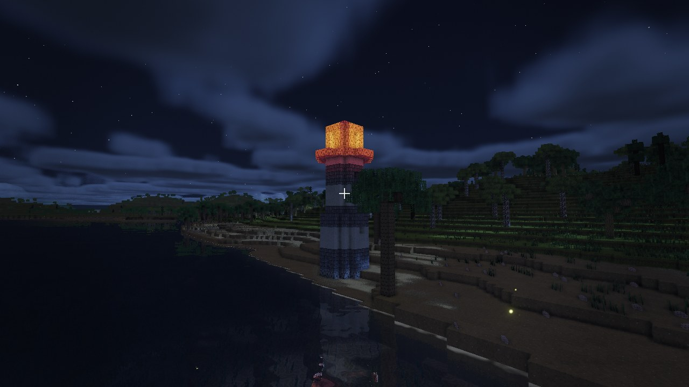
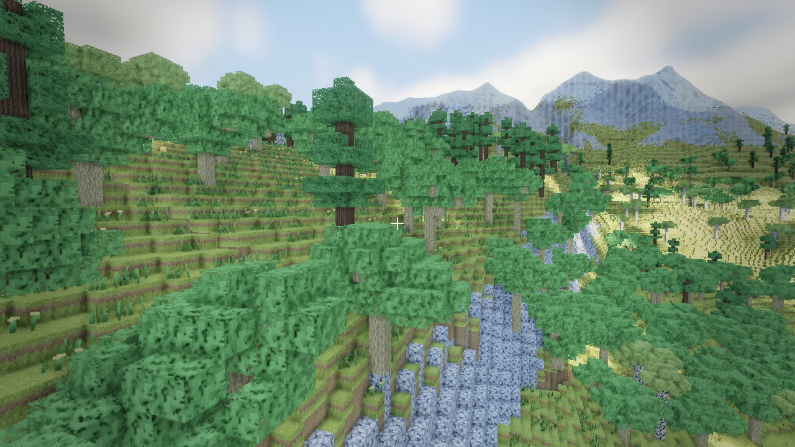
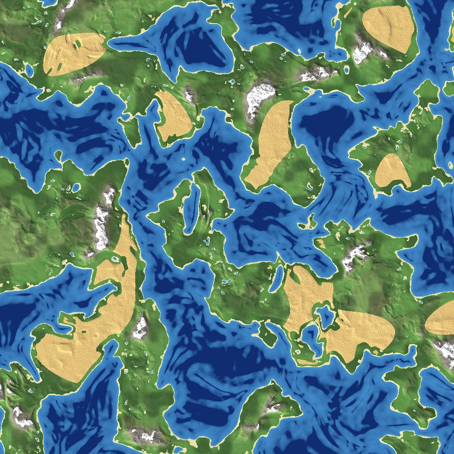

# Voxelium

a voxel game I wrote from scratch in C++ and OpenGL, no engine. endless worlds with real seas,
mountain ranges, caves, weather and animals, all streamed in and lit in real time.

| | |
|---|---|
|  |  |
|  |  |

## download

grab `voxelium-win64.zip` from the releases page, unzip it anywhere and run `voxelium.exe`.
windows, and any GPU with OpenGL 4.6.

## the world

every world comes from a seed. there are proper seas with islands and deep water past the
shallow shelves, coasts that start with a wide sandy beach and only slowly climb into the
country behind it, mountain ranges that run for kilometres with foothills, bare rock and snow
on top, and big deserts full of dunes and cacti. forests are oak, birch and spruce with open
meadows between the dense parts, and spruce takes over up in the cold.

you can see terrain about 5 km out, way past the chunks that are actually loaded, so the
mountains across the sea are really there instead of the world ending in fog. there's no
height limit either, dig down or build up as far as you want.

*one world's map, straight from the generator, about 8 km across*

## underground

caves are big caverns, long winding tunnels and the odd ravine, with water pooled in the
lowest ones and stalactites hanging off the ceilings. coal and iron sit at their own depths,
and gravel in the roof comes down when you dig under it. caves are actually dark: the only
light is what's down there with you (glow crystals, your lamps) and whatever gets in from the
openings, and lamp light hangs in the air a little, so a lamp makes a pool of light you walk
out of into the dark.

old mineshafts run through the caves with lamps in the beams and plank bridges over the drops.

## structures

lighthouses on the coast (the lantern turns into a beacon at night), shipwrecks on the
seabed, broken ruins out in the desert, and sandstone pyramids with a lit chamber inside and
something hidden under it.

## water

water flows, and sand and gravel fall. the sea has real waves, flat at the beach and bigger
over deep water, and they get a lot bigger in a storm. it reflects the world around it, throws
caustics on the seabed and has light shafts coming down through it. under it there are coral
reefs (branching, brain, tube and glowing coral further down), kelp forests and seagrass.

## weather and sky

the weather runs itself: clouds build up, it rains or snows for a while, then it clears. no
rain over deserts, snow up on the peaks, and mist over the water at sunrise. the worst storms
are thunderstorms, with lightning bolts and thunder that arrives later the further away it
struck. snow settles while it falls and melts once it stops, and things only get wet where the
rain can actually reach, so caves and overhangs stay dry.

clouds cast shadows that roll across the ground, sunlight comes through the gaps in tree
canopies, and at night the moon lights the hills and casts its own shadows. the air changes
with where you are too: dusty over a desert, cool and salty over the sea, a bit green in a
forest.

## life

butterflies by day, fireflies at night, gulls and bird flocks overhead, fish in the water,
crabs on the beaches, turtles in the shallows and jellyfish that glow after dark. they're all
solid: you can't walk through them, punching one knocks it back and sends it running, and
swimming into a school of fish scatters it.

particles have physics too. block shards bounce and slide to a stop, sand puffs up under your
feet, sand streams across the dunes in the wind, and gusts sweep through the grass and leaves.

## building

hold left click to break (blocks have hardness, and you can see the crack spread), middle
click to place, F4 for the hotbar. lamps come in 25 colours, middle click one to change it.
save a world from the ESC menu under any name; only your edits are stored and the terrain
comes back from the seed, so a save is a few KB.

## sound

every block sounds like what it's made of, footsteps included. landing gets heavier the
further you fell, and there are splashes, swim strokes and bubbles. each place has its own
ambience: birds in the woods, cicadas, frogs at dusk, desert wind, surf and gulls on a beach,
a low hum over a reef, drips in caves. everything gets muffled underwater and through rock.

## settings

Low / Medium / High / Ultra presets, or change anything and it goes to custom. fov, the colour
grade, bloom and weather have their own tab, plus audio volumes and your worlds. if Ultra is
slow, turn **detail dist** down first, it's the biggest cost by far. the whole loaded world is
drawn in a single GPU call and the lighting runs on its own thread, which is most of why it
holds up at big render distances.

## controls

- wasd + mouse, space to jump, F5 switches walk/fly (fly: hold RMB, space/ctrl up/down,
  shift for fast, scroll for speed)
- hold LMB to break, MMB to place, F4 for the hotbar (1-8 or scroll)
- MMB on a lamp picks its colour
- ESC for settings (it pauses), F3 for the debug HUD, F2 saves your edits

## building it yourself

needs cmake 3.25+, a C++20 compiler, and internet on the first configure.

    cmake --preset mingw
    cmake --build --preset mingw-release

that's windows with gcc/mingw, no visual studio needed. on linux use `gcc` and `gcc-release`.
it opens straight in Rider or CLion too.

## credits

the bundled textures and recorded sounds are CC0, from opengameart.org:

- textures: [16x16 Block Texture Set](https://opengameart.org/content/16x16-block-texture-set) by ARoachIFoundOnMyPillow
- footsteps: [Fantozzi's Footsteps](https://opengameart.org/content/fantozzis-footsteps-grasssand-stone) by Fantozzi
- blocks, water and thunder: [75 CC0 breaking / falling / hit SFX](https://opengameart.org/content/75-cc0-breaking-falling-hit-sfx),
  [100 CC0 SFX #2](https://opengameart.org/content/100-cc0-sfx-2) and
  [40 CC0 water / splash / slime SFX](https://opengameart.org/content/40-cc0-water-splash-slime-sfx) by rubberduck
- caves: [Loopable Dungeon Ambience](https://opengameart.org/content/loopable-dungeon-ambience) by JaggedStone,
  [Dripping water loop](https://opengameart.org/content/dripping-water-loop) by Independent.nu
- night: [Crickets Ambient Noise](https://opengameart.org/content/crickets-ambient-noise-loopable) by Wolfgang_ (recorded by Ted Kerr)
- day: [Forest Ambience](https://opengameart.org/content/forest-ambience) by TinyWorlds
- beach: [Beach Ocean Waves](https://opengameart.org/content/beach-ocean-waves) by jasinski,
  [Solo Seagull Sound Effects](https://opengameart.org/content/solo-seagull-sound-effects) by Rango Mango
- cicadas: [Swamp Environment Audio](https://opengameart.org/content/swamp-environment-audio) by LokiF

the birds, desert wind, leaves, frogs and reef hum are synthesized by `scripts/gen_ambience.py`.
