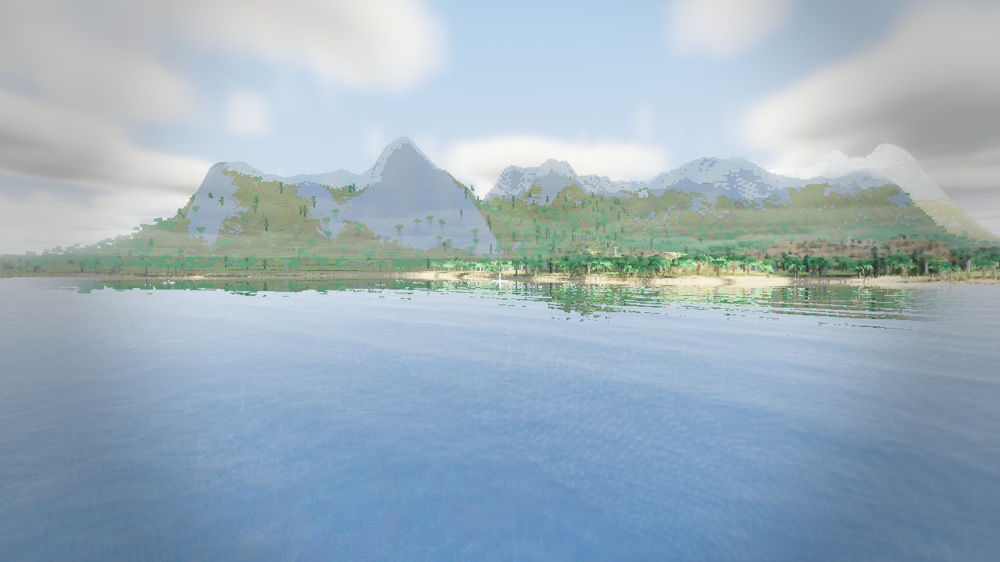
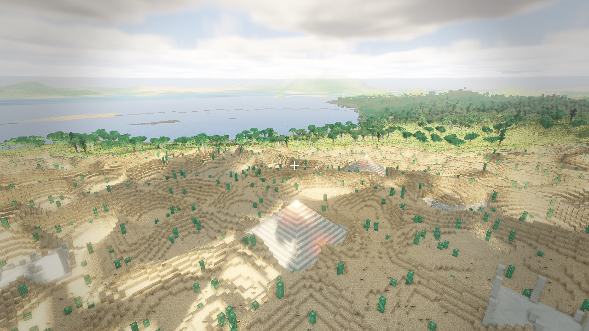
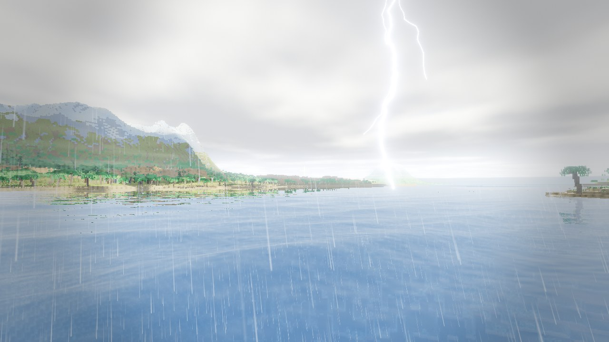

# Voxelium

A voxel game I made from scratch in C++ and OpenGL (I'm aware that I could have used a game engine but it's more fun this way)



It's a Minecraft-ish sandbox, but with more realistic terrain generation, better and more optimized graphics and cool lighting.

## Download

Get `voxelium-win64.zip` from Releases, unzip it, run `voxelium.exe`. Windows only for now, and your GPU needs OpenGL 4.6.

## What's in it

- Endless worlds from a seed, with oceans, beaches, mountains, deserts and forests
- Caves, ravines, flooded caves and old mineshafts naturally generated
- Lighthouses, shipwrecks, desert ruins and pyramids. There's also a cool easter egg under the pyramids too :D
- Actual physics for the water (waves and all) and sand shifting via particles and gravity
- Rain that makes puddles, snow that piles up and melts, and thunderstorms with actual lightning
- Crabs, turtles, fish, glowing jellyfish, birds, butterflies and fireflies. You can punch all of them and they will run (thats all they do)
- No build height limit, lamps in 25 colours, and save files that are only a few KB because they only store what you changed



## Controls

WASD and mouse to move, space to jump, F5 to switch between walking and flying (in fly mode you hold right click to look around). Hold left click to break, middle click to place. Middle click a lamp to change its colour. F4 is the hotbar, ESC is settings, F3 is the debug screen, F2 saves your edits.

If your game lags, turn down the detail distance in settings since it's the most expensive setting.

## Problemos I encountered
- A NaN turned the seabed into solid black rectangles and then a different NaN later put black squares on the screen every time it rained
- The mountains were random spikes, then walls, then 40 block deep trenches running in straight lines through the hills, took about five tries to get actual mountain ranges
- Tree tops looked unlit for ages. They were lit, the auto exposure was just staring at the sky
- If you walked away from spawn nothing would generate, and you would only see glitchy chunks
- Funny memory leak (the game was eating 20 gigs)



## How it works

Chunks are greedy meshed into 16 byte quads with no vertex buffers, the GPU does the culling, and the whole visible world is one indirect draw call. Lighting is flood filled on its own thread. The renderer has cascaded shadows, SSAO, volumetric light, bloom and TAA, and the water is tessellated near the camera. Libraries are GLFW, glm, Dear ImGui, FastNoise2, stb, miniaudio and unordered_dense, everything else is written from scratch.

To build it you need CMake 3.25+ and a C++20 compiler

```
cmake --preset mingw
cmake --build --preset mingw-release
```

That's MinGW on Windows and on Linux use the `gcc` presets.

## Credits

[16x16 Block Texture Set](https://opengameart.org/content/16x16-block-texture-set) by ARoachIFoundOnMyPillow,
[Fantozzi's Footsteps](https://opengameart.org/content/fantozzis-footsteps-grasssand-stone) by Fantozzi,
[75 CC0 breaking / falling / hit SFX](https://opengameart.org/content/75-cc0-breaking-falling-hit-sfx), [100 CC0 SFX #2](https://opengameart.org/content/100-cc0-sfx-2) and [40 CC0 water / splash / slime SFX](https://opengameart.org/content/40-cc0-water-splash-slime-sfx) by rubberduck,
[Loopable Dungeon Ambience](https://opengameart.org/content/loopable-dungeon-ambience) by JaggedStone,
[Dripping water loop](https://opengameart.org/content/dripping-water-loop) by Independent.nu,
[Crickets Ambient Noise](https://opengameart.org/content/crickets-ambient-noise-loopable) by Wolfgang_ (recorded by Ted Kerr),
[Forest Ambience](https://opengameart.org/content/forest-ambience) by TinyWorlds,
[Beach Ocean Waves](https://opengameart.org/content/beach-ocean-waves) by jasinski,
[Solo Seagull Sound Effects](https://opengameart.org/content/solo-seagull-sound-effects) by Rango Mango
[Swamp Environment Audio](https://opengameart.org/content/swamp-environment-audio) by LokiF.
