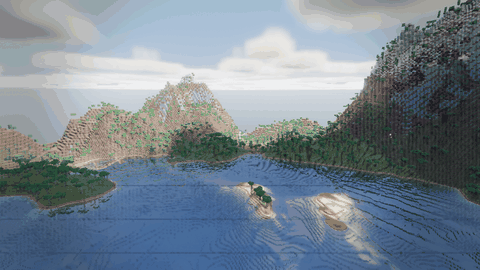

# Voxelium

voxel engine from scratch in C++20 + OpenGL 4.6 (core profile, DSA everywhere). no engine,
no bloat. every optimization below is a measured number, not a vibe — see "what's in it".

captured with the engine's own `--flythrough` harness mode — a fully-settled world first
(no streaming pop-in), then a smoothly interpolated camera path, exactly so a promotional
clip never shows the thing the rest of the test suite exists to catch.

## building

needs cmake 3.25+, a C++20 compiler, and git + network on the first configure (deps are
fetched and pinned in `cmake/Dependencies.cmake`, glad is vendored in `external/`).

windows with gcc/mingw (what I use, no visual studio needed):

    cmake --preset mingw
    cmake --build --preset mingw-release

linux:

    cmake --preset gcc
    cmake --build --preset gcc-release

there's also an `msvc` preset if you have VS lying around. I don't, so it's unverified.

`harden` is the same build with libstdc++ container assertions turned on (`cmake --preset
harden`, `cmake --build --preset harden-release`). worth running when you suspect a data
race — the assertions are the reason a real one got caught, and unlike a debug build this
one is fast enough to actually stream a world.

works out of the box in JetBrains Rider/CLion — open the repo folder, pick the `mingw`
preset (or the IDE's bundled toolchain), hit run.

## running

run `voxelium` from anywhere — it finds `assets/` by walking up from the exe, so build
trees and IDE working dirs just work.

controls:

- F3 debug HUD, ESC settings/pause, F4 hotbar, F5 walk/fly, F2 save edited chunks
- fly: hold RMB, wasd + space/ctrl, shift = fast, scroll = speed
- walk: wasd, space to jump, mouse look
- LMB **hold** to break (blocks have hardness, and the crack shows on the block), MMB place
- MMB while looking at a lamp opens its colour picker; the colour sticks for lamps you place
- F4 opens the hotbar (keys 1-8 or scroll to pick a block)

ESC opens the settings menu (it pauses too), in five tabs:

- **quality** — Low / Medium / High / Ultra presets, plus everything they set: render
  distance, render scale, the shader tier, shadow map size, and each effect toggle. the
  preset is worked out from the values rather than remembered, so touching any of them
  flips it to "custom" straight away.
- **visuals** — the things a preset deliberately does *not* touch, because they are taste
  and not performance: fov, crosshair, day/night cycle, night vision, exposure, bloom,
  and the grade (saturation, contrast, temperature, vignette, grain).
- **audio** — master plus world/interface/ambience buses, and how much solid rock muffles a
  sound heard through it.
- **world** — seed, save, load, delete, new world.
- **controls** — key reference.

presets are measured, not guessed: **Low 3.47 / Medium 4.61 / High 6.09 / Ultra 7.74 ms**
at 1280x720 (mean of the three bench views). High is deliberately the build that existed
before presets did, so the others are an A/B against a known reference. changing the tier
recompiles the shaders — sample counts are compile-time constants, because a uniform loop
bound doesn't unroll and would make Ultra slower than having no presets at all. the binary
cache means the second visit to a preset is nearly free.

F3 is the read-only diagnostics overlay — frame graph, timings, chunk/arena stats, log.

weather is in the visuals tab: rain, snow, and wet surfaces that only get wet where the
sky can actually reach them — caves, overhangs and ledge undersides stay dry, because the
shading reads the same voxel sky access the sun does.

night is lit by the moon, not by a raised ambient floor — it rides the same shadow cascades
the sun does, so hills have a lit side after dark and the fill can stay low.

## sound

blocks sound like what they're made of, footsteps included. breaking, placing and walking
each try the exact block first, then its **material** (stone, wood, glass, grass, sand,
snow, dirt, gravel, water), then a generic clip — which matters because this engine stores
data in the block id, so water is seven ids and a lamp is twenty-five, and keying audio on
the id alone meant twenty-five copies of one file.

you also get: a scuff when you jump, a landing that gets heavier the further you fell (a
step off one block is a stride, not a drop), splashes going into and out of water, swim
strokes, and bubbles while your head is under.

ambience is eight looping beds crossfaded by where you actually are — day, night, wind,
cave, deep underground, underwater, rain, and near water. "am i in a cave" is read off the
voxel **sky light** rather than by casting rays, since the light engine has already worked
that out, and it needs you to be enclosed *and* underground, so an overhang isn't a cave.
heavy rain gets occasional thunder, rolled off by how much sky you can see.

going underwater runs the world and ambience through a real low-pass sweeping 18 kHz down
to 700 Hz — menus stay dry, because a menu click isn't in the water with you. sounds are
also muffled by solid blocks between them and your ear, one raycast per sound, with its own
slider.

everything bundled is **CC0** with its source listed in `sounds/README.md`, and no clip is
required — delete any of them and the engine just stays quiet for that one. drop your own
in and they take over; the naming rules are in that same file.

## worlds

every launch rolls a **new seed**, so the world you are in is scratch. if you want to keep
one, open ESC, give it a name and hit save — it lands in `saves/worlds/<name>/` with the
seed that made it. the same panel lists what you have saved (seed and size) and will load
or delete any of them. loading and starting a new world both go behind the loading screen,
so the world is built before you are standing in it.

only your edits are stored, never the terrain — that regenerates from the seed — so a saved
world is usually a few tens of KB.

## what's in it

12 milestones deep:
binary greedy meshing + vertex pulling (8-byte quads, no VBO), palette-compressed chunks,
a jthread job system, GPU-driven culling with the whole world in one indirect draw call,
cave culling, flood-fill RGB block + sky lighting, FastNoise2 terrain with caves and ores,
player physics + block editing, a forward HDR pipeline (cascaded shadows, SSAO,
volumetrics, bloom, ACES), flowing water, falling sand and gravel, cross-plane grass and
flowers, particles, and region-file persistence.

there's no world height limit either — chunks exist at any Y, so you can dig or build as
far as you like and the loaded band follows you.

`voxelium --smoke [out.bmp]` renders offscreen, checks that pixels actually got drawn,
writes a screenshot and exits 0/1. headless self-check, useful for CI later.

`voxelium --flythrough [frames]` is what made the clip at the top of this file: settles a
world, then interpolates the camera through a short path, writing one `flyframe_NNNN.bmp`
per frame for something else to assemble into a GIF.
