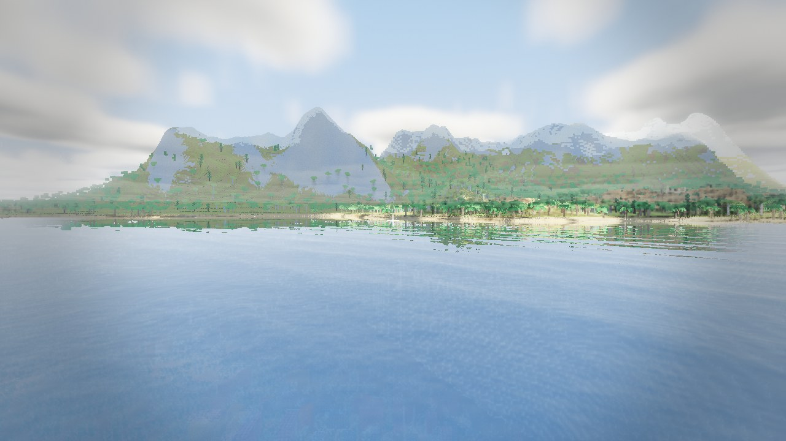
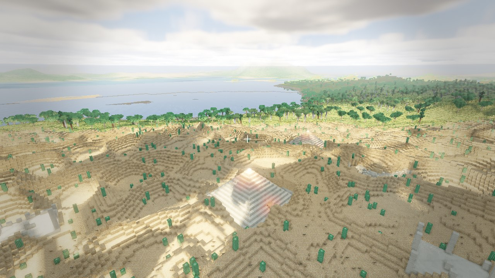
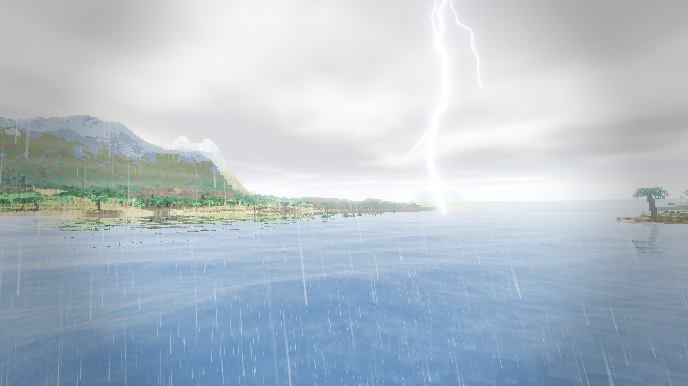

# Voxelium

A voxel game I made from scratch in C++ and OpenGL (I'm aware that I could have used a game engine but it's more fun this way)



It's a Minecraft-ish sandbox, but with more realistic terrain generation, better and more optimized graphics and cool lighting.

## Download

Get `voxelium-win64.zip` from Releases, unzip it, run `voxelium.exe`. Windows only for now, and your GPU needs OpenGL 4.6.

## What's in it

- Endless worlds from a seed, with oceans, mountain ranges, rivers that actually run down to the sea, lakes and 27 biomes from jungle to tundra
- Way more colour: cherry blossom groves on the hills, autumn forests in red, orange and gold, white spring blossom, golden aspens, flower fields full of lavender and poppies, giant redwoods, dark forests with huge mushrooms, bamboo, mangroves on hot coasts and oases out in the desert
- Caves that go way down to a bedrock floor, with big caverns, underground lakes and old mineshafts. They change with what's above them: lush caves with moss and glow berries under jungles and swamps, dripstone caves under deserts, ice caves under the snow, glowing mushroom caves deep down, and the odd crystal geode
- Mountains that aren't all the same: jagged alpine ranges, rounded old ones and ranges stepped in cliff bands, with scree, glaciers and alpine meadows. Volcanoes with crater lakes (some are islands), and karst towers sticking straight up out of the jungle
- Lighthouses, shipwrecks, desert ruins, pyramids, log cabins in the woods, standing stones and ruined watchtowers on the hills. There's also a cool easter egg under the pyramids too :D
- Actual physics for the water (waves and all) and sand shifting via particles and gravity
- Rain that makes puddles, snow that piles up and melts, and thunderstorms with actual lightning
- Sheep, cows, pigs, chickens, deer, foxes, rabbits, frogs, crabs, turtles, fish, glowing jellyfish, birds, bats, bees, butterflies and fireflies. You can punch all of them and they will run (thats all they do)
- No build height limit, lamps in 25 colours, and save files that are only a few KB because they only store what you changed



## Controls

WASD and mouse to move, space to jump, ctrl to sprint, F5 to switch between walking and flying (space and ctrl go up and down, shift is fast, scroll changes the speed). Hold left click to break, right click to place, middle click to grab the block you're looking at. E opens every block in the game, F4 is the hotbar and 1-9 pick a slot, shift + middle click a lamp to change its colour. ESC is settings, F3 is the debug screen, F2 saves the world (the first save needs a name, so it opens ESC for that), F6 takes a screenshot.

If your game lags, turn down the detail distance in settings since it's the most expensive setting.

## Problemos I encountered
- A NaN turned the seabed into solid black rectangles and then a different NaN later put black squares on the screen every time it rained
- The mountains were random spikes, then walls, then 40 block deep trenches running in straight lines through the hills, took about five tries to get actual mountain ranges
- Tree tops looked unlit for ages. They were lit, the auto exposure was just staring at the sky
- If you walked away from spawn nothing would generate, and you would only see glitchy chunks
- Funny memory leak (the game was eating 20 gigs)



## How it works

Chunks are greedy meshed into 16 byte quads with no vertex buffers, the GPU does the culling, and the whole visible world is one indirect draw call. Lighting is flood filled on its own thread. The renderer has cascaded shadows, SSAO, volumetric clouds and light, sunlight that bounces off the ground into shade, bloom and TAA, and the water is tessellated near the camera. Past the loaded chunks the terrain keeps going as a heightfield out to about 7 km. Libraries are GLFW, glm, Dear ImGui, FastNoise2, stb, miniaudio and unordered_dense, everything else is written from scratch.

To build it you need CMake 3.25+ and a C++20 compiler

```
cmake --preset mingw
cmake --build --preset mingw-release
```

That's MinGW on Windows and on Linux use the `gcc` presets.

## Credits

The gullies on the mountains are my take on Rune Skovbo Johansen's erosion filter idea.

[16x16 Block Texture Set](https://opengameart.org/content/16x16-block-texture-set) by ARoachIFoundOnMyPillow,
[Fantozzi's Footsteps](https://opengameart.org/content/fantozzis-footsteps-grasssand-stone) by Fantozzi,
[75 CC0 breaking / falling / hit SFX](https://opengameart.org/content/75-cc0-breaking-falling-hit-sfx), [100 CC0 SFX #2](https://opengameart.org/content/100-cc0-sfx-2) and [40 CC0 water / splash / slime SFX](https://opengameart.org/content/40-cc0-water-splash-slime-sfx) by rubberduck,
[Loopable Dungeon Ambience](https://opengameart.org/content/loopable-dungeon-ambience) by JaggedStone,
[Dripping water loop](https://opengameart.org/content/dripping-water-loop) by Independent.nu.

The plant, ground, tree and building tiles added with the new biomes come from
[Minetest Game](https://github.com/luanti-org/minetest_game) (CC BY-SA 3.0) by celeron55, Cisoun, VanessaE,
Calinou, PilzAdam, paramat and the other Minetest Game contributors. Some are recoloured or layered
over the dirt tile.

Music: Meditation Impromptu 01, 02 and 03 and Dreamer by Kevin MacLeod ([incompetech.com](https://incompetech.com)),
licensed under [CC BY 4.0](https://creativecommons.org/licenses/by/4.0/).

Ambience, animal calls and interface sounds, all CC0 on Freesound:
[Fly_Buzzing_Edited](https://freesound.org/s/443059/) by AmberdeMeillon,
[Wandering](https://freesound.org/s/455855/) by Andrewkn,
[frog](https://freesound.org/s/251938/) by BinaryMonkFlint,
[Many Frogs at Night in Marsh](https://freesound.org/s/569543/) by bmacphail,
[Chicken clucking](https://freesound.org/s/456803/) by Breviceps,
[Lake Night](https://freesound.org/s/744098/) by ChristmasKrumble666,
[Wind__Artic__Cold](https://freesound.org/s/117136/) by cobratronik,
[R28-18-Single Frog Chirps](https://freesound.org/s/479833/) by craigsmith,
[American robin 1](https://freesound.org/s/512825/) by deleted_user_11205508,
[Fast Woodpecker](https://freesound.org/s/677524/) by deleted_user_12579677,
[blackbird-evening](https://freesound.org/s/521558/) by echobones,
[Frog](https://freesound.org/s/536759/) by egomassive,
[Button hover](https://freesound.org/s/338229/) by Fachii,
[Wind blowing in the bush on the top of Kitt Peak mountain. (USA, Arizona)](https://freesound.org/s/135193/) by felix.blume,
[Chicken Clucking](https://freesound.org/s/823065/) by Filmscore,
[Windforce 4-5 wind](https://freesound.org/s/170471/) by finalCrystine,
[forest birds Skephult part 1](https://freesound.org/s/816111/) by forestfjord,
[Bees buzzing 2](https://freesound.org/s/528934/) by fthgurdy,
[Videogame Menu Select](https://freesound.org/s/471937/) by Fupicat,
[Fox Barking](https://freesound.org/s/397655/) by gadzooks,
[owl_hooting_000102_0145S3 002-070 000-002 068-074](https://freesound.org/s/558396/), [owl_hooting_000102_0145S3 002-070 000-002 007-015](https://freesound.org/s/558398/) by Gerent,
[Forest cabin summer rain 1](https://freesound.org/s/719062/) by giddster,
[Bako National Park, Borneo Island, Rain Forest Ambience daytime 01.10.2013 Roland R-26 OMNI Mics](https://freesound.org/s/333225/) by gladkiy,
[Ocean Waves on Beach](https://freesound.org/s/623052/) by goochiano,
[Wind rustling leaves through tree Cardiff](https://freesound.org/s/848978/) by gsparrysound,
[The song of an Eurasian Wren](https://freesound.org/s/853671/) by hoshisato,
[Water stream, river](https://freesound.org/s/563004/) by jonasdenfyren,
[Bee Buzzing](https://freesound.org/s/481647/) by JonCon_Library,
[AMBForst_Birds_Day_Yport_260128_edn](https://freesound.org/s/843607/) by kevinklang,
[Underwater Ambience](https://freesound.org/s/393819/), [Dark Dungeon Ambience](https://freesound.org/s/516566/) by Kinoton,
[Forest ambience near a farm](https://freesound.org/s/854010/) by LukaCafuka,
[Seagulls_short](https://freesound.org/s/510917/) by Lydmakeren,
[Sheep baaing 5 - Norwegian sheep expressing itself concisely](https://freesound.org/s/710300/) by michaelperfect,
[Hooded Crow: Cawing](https://freesound.org/s/741366/) by Mish7913,
[Peruvian Amazon birds frogs daytime](https://freesound.org/s/653743/) by nonamethefish,
[AMBIENCE-EXTERIOR-EVENING-COUNTRYSIDE-CRICKETS](https://freesound.org/s/727816/) by pblzr,
[Felix Blume - Cows Mooing 1 min](https://freesound.org/s/181955/), [Pig Oink](https://freesound.org/s/442906/), [Crow Caw](https://freesound.org/s/813115/) by qubodup,
[Forest Day - Bird Chirps, Insects](https://freesound.org/s/788118/), [Wetlands Night - Frogs, toads, bird whistles](https://freesound.org/s/826445/) by RealSquink,
[Red-bellied Woodpecker](https://freesound.org/s/811762/) by reise,
[Night_Breeze_Crickets_Kuipto_Forrest_adelaide_Australia_ambience 01](https://freesound.org/s/699141/) by roisin.gleeson,
[Ewe Shetland Sheep Baa](https://freesound.org/s/692900/) by satoristudios3,
[Peaceful Background Music](https://freesound.org/s/673356/) by Seth_Makes_Sounds,
[foxBark2](https://freesound.org/s/173208/) by Setzilla,
[Gentle Rain](https://freesound.org/s/501243/) by shelbyshark,
[Cow moo #8](https://freesound.org/s/513565/) by spurioustransients,
[Seagull single call](https://freesound.org/s/263786/) by steaq,
[SFX UI Button Click](https://freesound.org/s/253168/) by suntemple,
[Owl-4](https://freesound.org/s/871240/) by SyntaxSeed,
[Gentle waves on a lake](https://freesound.org/s/614299/) by TheFlyFishingFilmmaker,
[birds on morning](https://freesound.org/s/546521/) by trezz77,
[Bird - Red-shouldered hawk](https://freesound.org/s/770032/), [Desert sand - Dune atmosphere](https://freesound.org/s/825860/) by Vrymaa,
[Ambience-Rural-Early Evening-Birds Chirping, Light Wind, Leaves on Trees Rustling, Near and Light Traffic, Light Footsteps, Dog Barking](https://freesound.org/s/418271/) by yeemeng,
[Ocean_coast_04_092025_0659AM](https://freesound.org/s/827530/) by YevgVerh.
